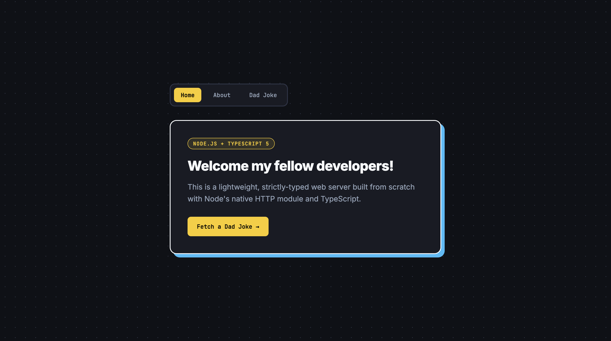
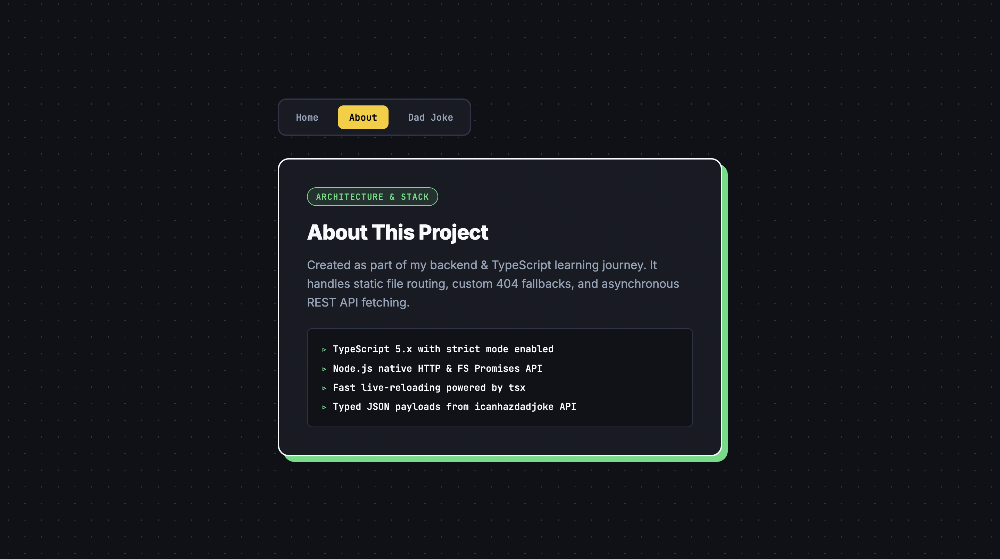
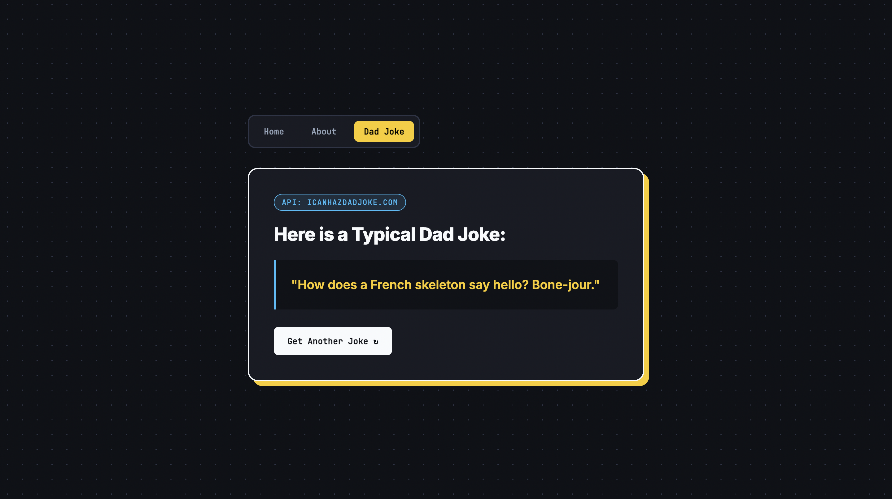

# 🚀 TypeScript & Node.js Web Server (Dad Jokes API)

A lightweight, strictly-typed Node.js server built with TypeScript. It fetches random jokes from the external **icanhazdadjoke API**, validates the payload using TypeScript interfaces, and serves static pages (`Home`, `About`, `404`) via Node's native `http` module.

## 📷 Preview

| Home Page | About Page | Dad Joke View |
| :---: | :---: | :---: |
|  |  |  |

## 🛠️ Tech Stack

* **Node.js** & **TypeScript 5.x** (`"strict": true` enabled)
* **tsx** – modern, esbuild-based runner for instant live-reloading (replacing legacy `ts-node-dev`)
* **node-fetch** – for external REST API integration

## 🚀 Getting Started

1. **Install dependencies:**
   ```bash
   npm install
   ```

2. **Run in development mode (with live-reload):**
   ```bash
   npm start
   ```

3. **Build & run for production:**
   ```bash
   npm run build
   node build/index.js
   ```

## 📈 Status / Roadmap

- [x] Project setup with TypeScript 5 & `tsx`
- [x] HTTP server implementation & static routing (`http` & `fs` modules)
- [x] Shared CSS stylesheet integration
- [x] `icanhazdadjoke.com` API integration & response typing

---
*Created by Marta Łoskot :)*